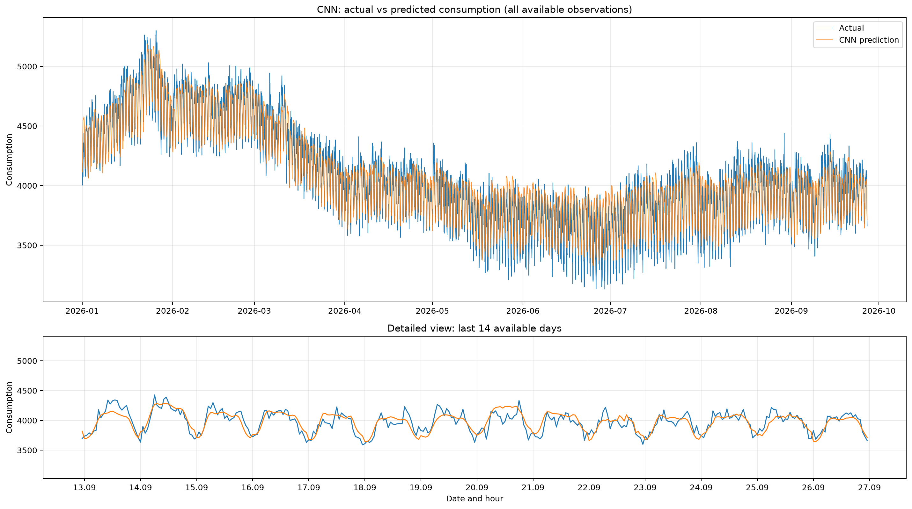

# Анализ метрик CNN (1D)

## 1. Данные и область оценки

Анализ выполнен по файлу `rolling_predictions.csv` из rolling-прогноза CNN.

| Показатель | Значение |
|---|---:|
| Количество наблюдений | 6 456 часовых значений |
| Фактический период в CSV | 01.01.2026–26.09.2026 |
| Количество оценённых дней | 269 |
| Среднее фактическое потребление | 4 064,48 |
| Среднее предсказанное потребление | 4 097,67 |
| Корреляция факта и прогноза | 0,9634 |
| Средняя абсолютная ошибка (MAE) | 92,65 |
| Среднее смещение прогноза | +33,20 |

> В `rolling_summary.txt` указан период до 31.12.2026, однако фактические строки `rolling_predictions.csv` заканчиваются 26.09.2026. Поэтому выводы относятся к доступному в CSV периоду.

## 2. Итоговые метрики

| Метрика | Среднее | Медиана | Стандартное отклонение | Минимум | Максимум |
|---|---:|---:|---:|---:|---:|
| MSE | 13 927,61 | 9 800,34 | 11 967,29 | 1 279,25 | 76 961,21 |
| RMSE | 110,33 | 99,00 | 41,96 | 35,77 | 277,42 |
| MAPE, % | 2,35 | 2,04 | 1,15 | 0,58 | 7,18 |
| TOP3_HIT, % | 34,32 | 33,33 | 26,84 | 0,00 | 100,00 |

### Интерпретация

- **MAPE 2,35%** означает, что в среднем ошибка прогноза составляет около 2,4% от фактического потребления. Для задачи прогнозирования нагрузки это хороший уровень точности.
- **RMSE 110,33** показывает средний масштаб ошибки в исходных единицах потребления. Медиана ниже среднего — 98,99, поэтому отдельные дни с большими ошибками заметно увеличивают среднее значение.
- **MSE** подтверждает наличие выбросов: максимальное дневное значение 76 961,21 существенно выше медианного 9 800,34. Для оценки качества полезно одновременно смотреть на среднее и медиану.
- **Корреляция 0,9634** показывает, что CNN хорошо воспроизводит общую динамику и сезонные колебания ряда.
- **Положительное смещение +33,20** означает небольшое систематическое завышение прогноза. При этом разброс предсказаний ниже разброса факта: стандартное отклонение прогноза — около 379,53 против 415,32 у фактических значений. Это указывает на некоторое сглаживание пиков и спадов.
- **TOP3_HIT 34,32%**: в среднем примерно в каждом третьем дне модель корректно определяет три наиболее высоких часовых значения. Для задачи именно выбора пиков этот показатель заметно слабее общих метрик точности.

## 3. Динамика качества по месяцам

| Месяц | RMSE | MAPE, % | TOP3_HIT, % |
|---|---:|---:|---:|
| 2026-01 | 97,46 | 1,76 | 37,63 |
| 2026-02 | 79,08 | 1,39 | 35,71 |
| 2026-03 | 98,49 | 1,90 | 26,88 |
| 2026-04 | 91,07 | 1,89 | 28,89 |
| 2026-05 | 130,12 | 2,98 | 32,26 |
| 2026-06 | 155,08 | 3,79 | 43,33 |
| 2026-07 | 128,95 | 2,92 | 37,63 |
| 2026-08 | 105,46 | 2,25 | 41,94 |
| 2026-09 | 104,08 | 2,19 | 23,08 |

Наблюдается ухудшение качества в мае–июле: RMSE и MAPE растут, а в июне средняя MAPE достигает 3,79%. В августе–сентябре ошибка снижается, но остаётся выше уровня января–апреля. Вероятная причина — сезонные изменения нагрузки и более сложное воспроизведение летних пиков.

Лучший день по RMSE и MAPE — **12.02.2026**: RMSE 35,77 и MAPE 0,58%. Худший день — **16.07.2026**: RMSE 277,42, MAPE 7,18%, TOP3_HIT 0%. Этот день требует отдельной проверки исходных признаков и наличия аномального пика.

## 4. Сравнение фактических и предсказанных значений

На графике ниже показаны два уровня детализации: весь доступный период и последние 14 дней из CSV.

По графику можно оценить, что прогноз в целом повторяет форму временного ряда, но локальные экстремумы часто сглаживаются. Именно это объясняет сочетание высокой корреляции и более низкого TOP3_HIT.

## 5. Выводы и рекомендации

1. CNN демонстрирует хорошее качество для общего прогноза нагрузки: средняя относительная ошибка — 2,35%, корреляция с фактом — 0,9634.
2. Основная проблема модели — точное попадание в максимумы. Для сценария управления пиковыми нагрузками одной общей MAPE недостаточно: необходимо отдельно оптимизировать TOP3_HIT и ошибки на верхних квантилях нагрузки.
3. Модель имеет небольшой положительный bias и склонность сглаживать амплитуду. Полезно проверить калибровку прогноза, loss с повышенным весом для пиковых значений и дополнительные признаки календаря/сезонности.
4. Следует отдельно исследовать дни с RMSE выше среднего, особенно 16.07.2026, и проверить выбросы, пропуски, праздники и резкие изменения режима потребления.
5. Перед финальным сравнением моделей нужно синхронизировать период в отчёте и в CSV: summary заявляет весь 2026 год, а текущий файл содержит данные только по 26.09.2026.
